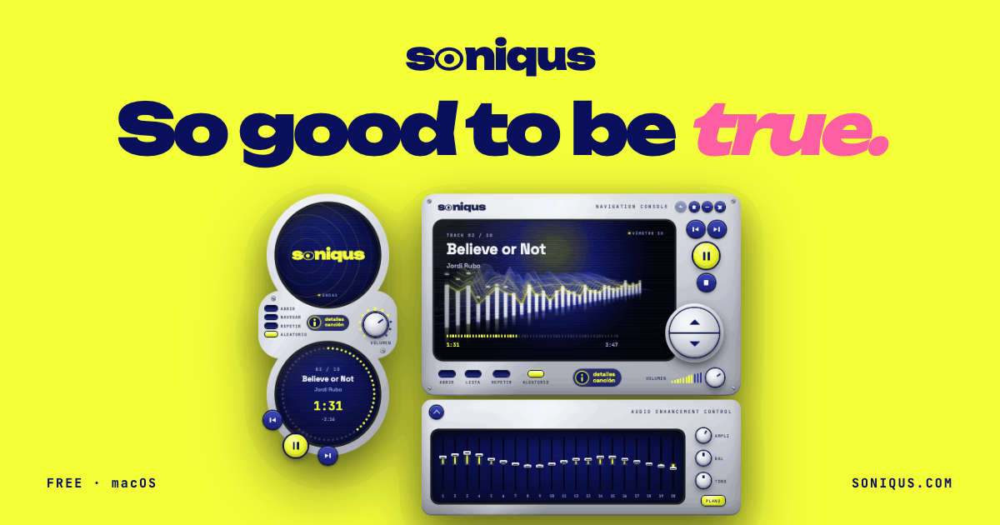
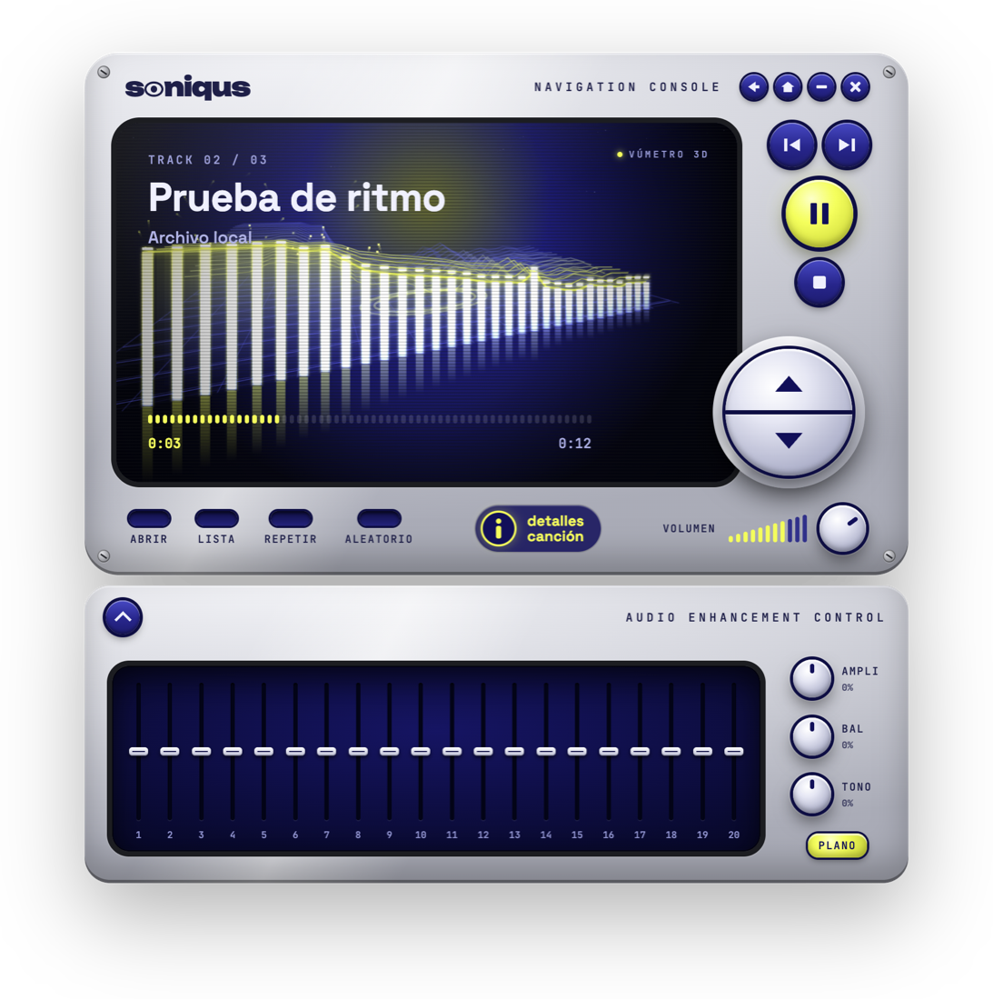
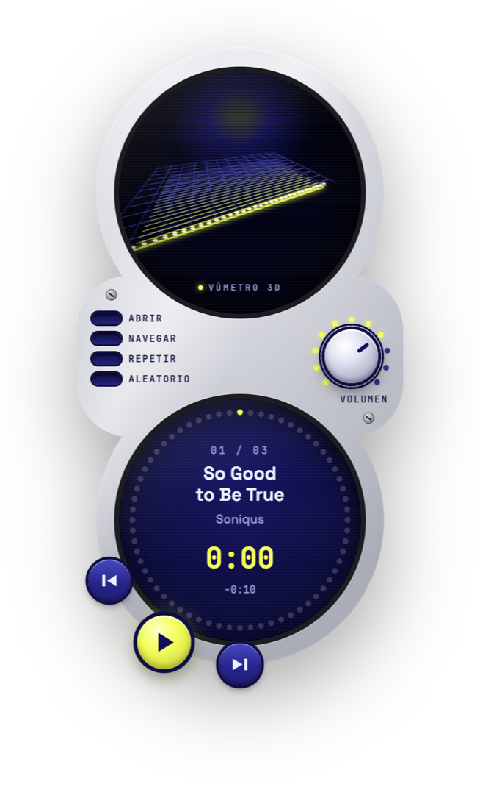
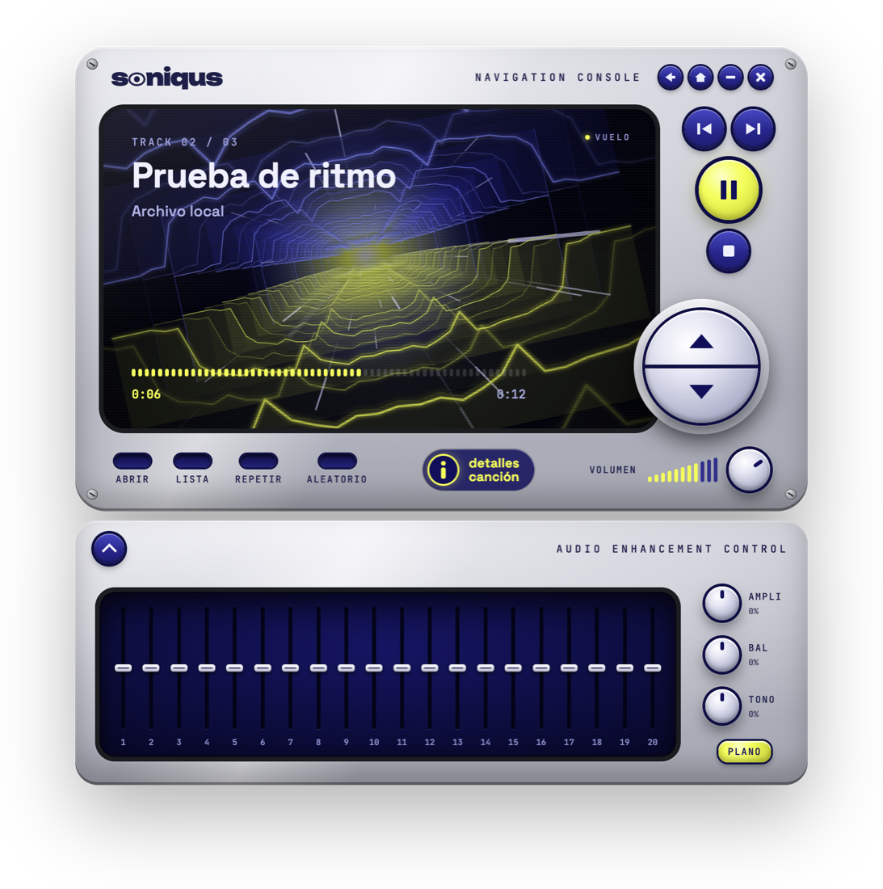
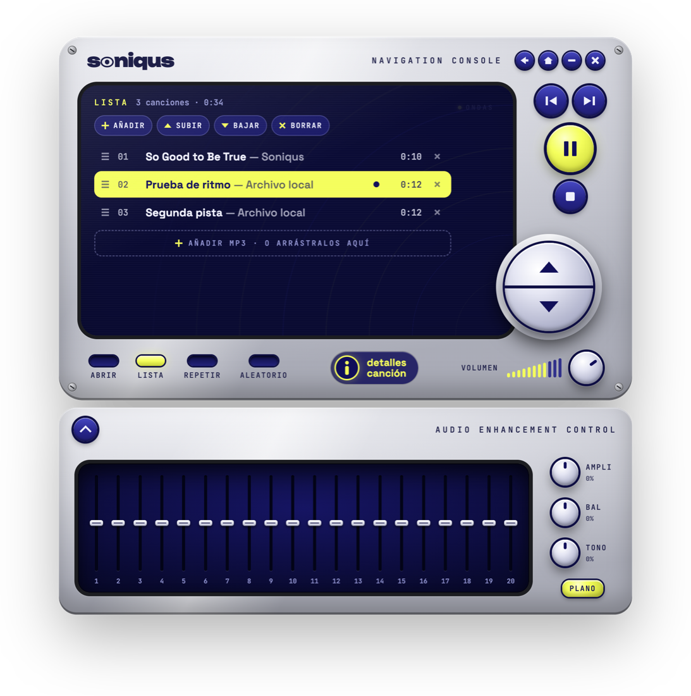
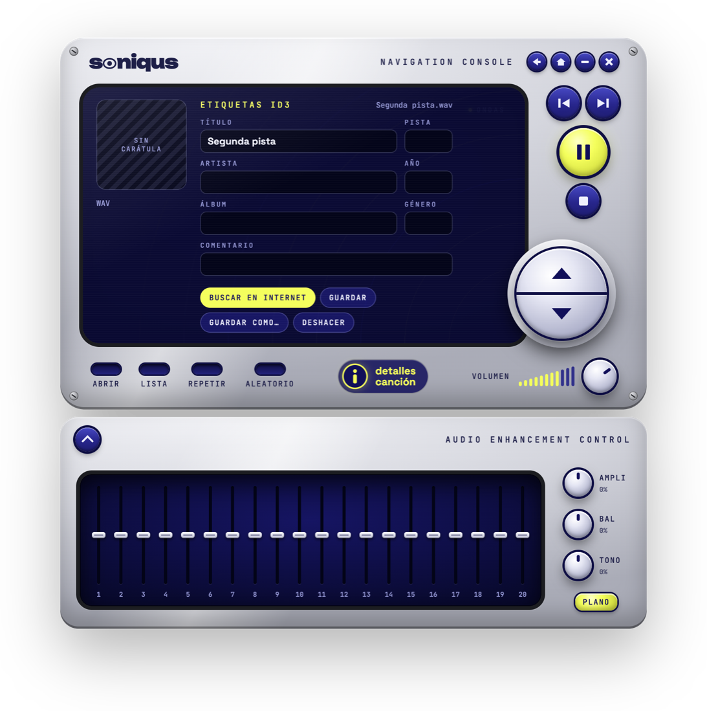
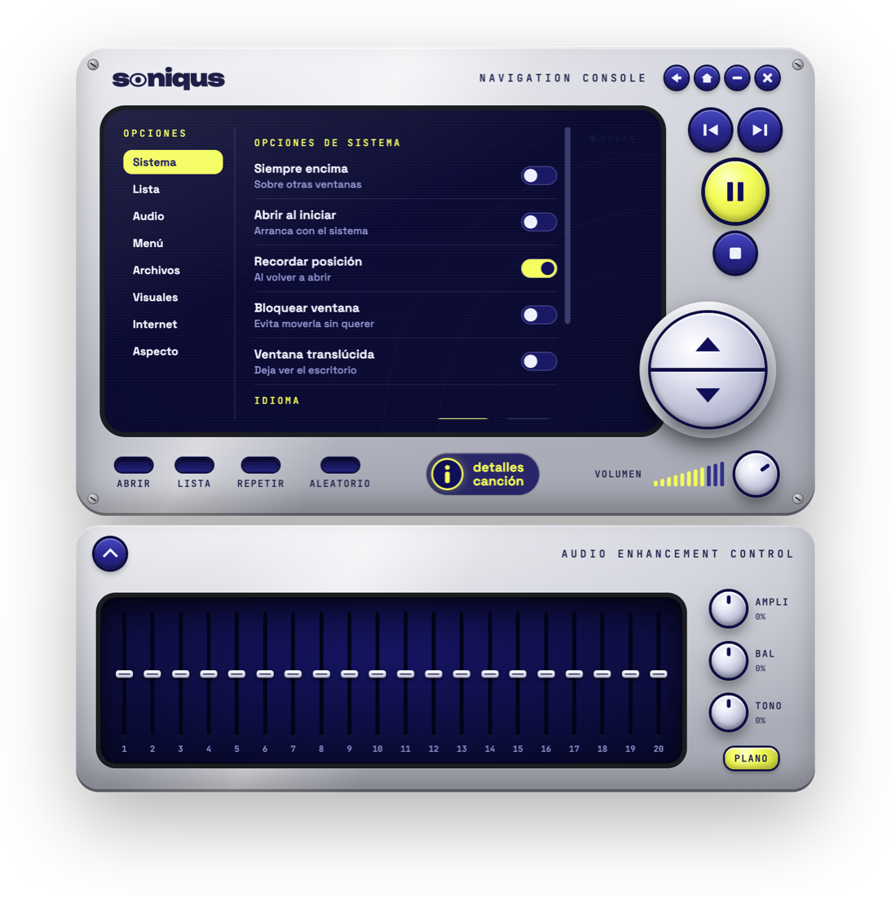
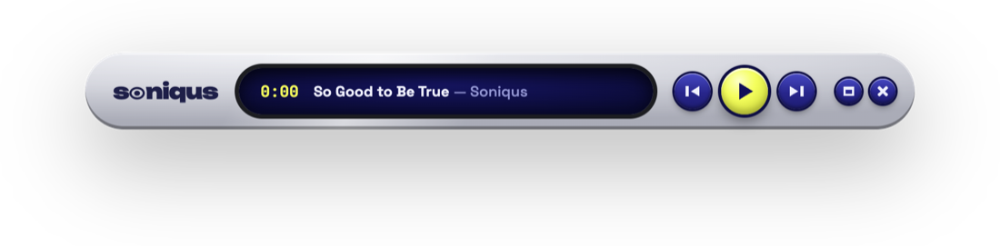

<p align="center">
  <a href="https://soniqus.com/es/"></a>
</p>

<h1 align="center">soniqus</h1>

<p align="center">
  <b>El reproductor que tu escritorio echa de menos desde 1999.</b><br>
  Alma de hardware, visuales que bailan cada golpe y cero suscripciones.
</p>

<p align="center">
  <a href="README.md">Read in English</a>
</p>

---

<p align="center">
  
  
</p>

## Qué es

**soniqus** es un reproductor de música de escritorio para macOS, gratuito y de código abierto. Es un homenaje a los reproductores con *skins* de finales de los 90: carcasa con relieve, pantallas redondas, botones de hardware, visuales que reaccionan al audio y un ecualizador de 20 bandas, hecho desde cero con herramientas de hoy.

Sin cuenta, sin anuncios y sin telemetría. Reproduce los archivos que ya tienes.

## Descarga

Baja el último `.dmg` desde **[Releases](https://github.com/nuvolacat/Soniqus/releases/latest)** o desde **[soniqus.com](https://soniqus.com/es/)**, ábrelo y arrastra soniqus a Aplicaciones.

> **Primer arranque.** La app todavía no está notarizada por Apple, así que macOS se negará a abrirla la primera vez. Haz clic derecho sobre la app y elige **Abrir**, o permítela en *Ajustes del Sistema → Privacidad y seguridad*. De momento, solo para Apple Silicon.

## Funciones

| | |
|---|---|
| **Tres modos de ventana** | Reproductor compacto de doble pantalla, *Navigation console* completa y una barra mini. Ventanas sin marco y con forma, que se arrastran por la carcasa. |
| **Ecualizador de 20 bandas** | De −12 a +12 dB por banda, presets y ruedas de ampli, balance y tono (doble clic en una rueda para volver a 0). |
| **Cuatro visuales en vivo** | Ondas, Vúmetro 3D, Halo y Vuelo, movidos por la señal real de audio. |
| **Editor de lista** | Añade archivos o carpetas, reordena arrastrando, atajos de teclado y listas `m3u` / `pls` / `cue`. |
| **Editor de etiquetas ID3** | Lee ID3v1/v2.2/2.3/2.4 y escribe ID3v2.4 en el archivo conservando la carátula y el resto de etiquetas. |
| **Búsqueda en internet** | Completa etiquetas y carátula con MusicBrainz y Cover Art Archive en un clic. |
| **Seis aspectos** | Aluminio claro, metal cepillado, grafito mate, azul anodizado, plástico humo y amarillo señal. |
| **Transiciones** | Iris, barrido CRT, vórtice, glitch, volteo 3D y deslizar, con entrada escalonada por bloques. |
| **Extras de audio** | Reverberación, fundido, grabación de la salida a WAV y volumen con el master del sistema. |
| **Formatos** | MP3, FLAC, OGG, Opus, WAV, M4A, AAC y radios por internet desde listas. |
| **Idiomas** | Español, Català, English. |
| **En el escritorio** | Siempre encima, ventana translúcida, bloqueo de posición, abrir al iniciar y recordar posición. |

<p align="center">
  
  
</p>
<p align="center">
  
  
</p>
<p align="center">
  
</p>

## Atajos de teclado

| Tecla | Acción |
|---|---|
| `Espacio` | Reproducir / pausa |
| `←` / `→` | Retroceder / avanzar 5 s |
| `↑` / `↓` | Visual anterior / siguiente (o moverse por la lista) |
| `Enter` | Reproducir la canción seleccionada |
| `Supr` | Borrar de la lista |
| `⌥↑` / `⌥↓` | Mover la canción seleccionada |
| `Esc` | Atrás |
| `⌘1` / `⌘2` / `⌘3` | Modo compacto / consola / barra mini |
| `⌘O` | Abrir archivos o carpetas |
| `⌘S` | Guardar la lista como `m3u` |

Doble clic en la carcasa alterna entre el modo compacto y la consola. Suelta archivos o carpetas en cualquier punto de la ventana para añadirlos.

## Compilar desde el código

Requisitos: macOS y [Node.js](https://nodejs.org) 22 o superior. Para el instalador hace falta además [`uv`](https://docs.astral.sh/uv/) (ejecuta `dmgbuild`).

```bash
git clone https://github.com/nuvolacat/Soniqus.git
cd Soniqus
npm install

npm start        # compila la interfaz y abre la app
npm run dist     # genera Soniqus.app y el .dmg en release/
npm run web      # genera la web en web/dist (necesita un .dmg en release/)
```

### Autoprueba silenciosa

La app puede recorrer sola todas las pantallas con el audio silenciado, guardar una captura de cada una y escribir un informe. Sirve para comprobar un cambio sin tocar el ratón:

```bash
SONIQUS_TEST=/tmp/soniqus-test npx electron .
```

## Cómo está hecho

soniqus es una app [Electron](https://www.electronjs.org) con interfaz en [React](https://react.dev), empaquetada con [esbuild](https://esbuild.github.io).

```
main.js              proceso principal: ventana con forma, protocolo sq://, ficheros, listas, diálogos
preload.js           el puente que ve la interfaz
tags.js              lector y escritor de ID3 y cabeceras MPEG
src/renderer/        lógica de la interfaz (app.jsx), idiomas y estilos
diseno/              el prototipo de diseño original: la única fuente de verdad de la interfaz
tools/convert.mjs    convierte el prototipo en vistas de React al compilar
tools/build.mjs      empaqueta la interfaz y sella la versión
tools/dist.mjs       empaqueta la app, dibuja el icono y monta el .dmg
tools/selftest.js    la autoprueba silenciosa
web/                 el generador de la web soniqus.com
```

Algunas cosas que conviene saber:

- **La interfaz se genera a partir del diseño.** `tools/convert.mjs` lee el prototipo HTML de `diseno/` y produce las vistas de React, así la app es fiel al diseño al píxel. Se edita el prototipo o el conversor, nunca los ficheros generados.
- **El audio** pasa por la Web Audio API: preamplificador → 20 filtros → envío a reverberación → balance → analizadores → fundido → volumen. Los archivos locales llegan al reproductor por un protocolo privado `sq://` con peticiones por rango.
- **Ventanas con forma.** La ventana es transparente y sin marco; los clics en el margen vacío pasan a lo que haya detrás mientras soniqus es la ventana activa.
- **Las versiones** siguen el formato `1.AA.MMDD.HHMM`, con la hora real de la compilación.

## Privacidad

soniqus solo se conecta a internet cuando se lo pides: para buscar etiquetas (MusicBrainz), traer una carátula (Cover Art Archive) o reproducir una radio que hayas añadido. Los ajustes y la lista se guardan en `~/Library/Application Support/Soniqus`; *Ajustes → Sistema → Borrar caché* los elimina.

## Contribuir

Las incidencias y los *pull requests* son bienvenidos. Mantén los cambios coherentes con el prototipo de diseño y pasa la autoprueba silenciosa antes de enviar un PR.

## Licencia

El código fuente se publica bajo la [licencia MIT](LICENSE): puedes usarlo, modificarlo y redistribuirlo libremente, también con fines comerciales, **siempre que cites al autor**.

**Citar al autor** significa conservar el aviso de copyright y el texto de la licencia (`Copyright (c) 2026 NUVOLACAT` y el fichero [LICENSE](LICENSE)) en toda copia o parte sustancial del código, en fuente o en binario. Si publicas una app basada en soniqus, la forma de hacerlo es una línea como *«Basado en soniqus, de NUVOLACAT — https://github.com/nuvolacat/Soniqus»* en tu pantalla «Acerca de» o en la documentación.

El nombre y el logotipo de **soniqus**, el icono de la app y la canción de bienvenida *«So Good to Be True»* son © NUVOLACAT y no están cubiertos por la licencia MIT: usa los tuyos si publicas un reproductor derivado.

soniqus incluye las tipografías Unbounded, Space Grotesk y JetBrains Mono (SIL Open Font License 1.1). Es un proyecto independiente, sin relación con Sonique ni con sus propietarios.

---

<p align="center">
  Hecho por <a href="https://nuvola.cat">nuvola</a>
</p>
