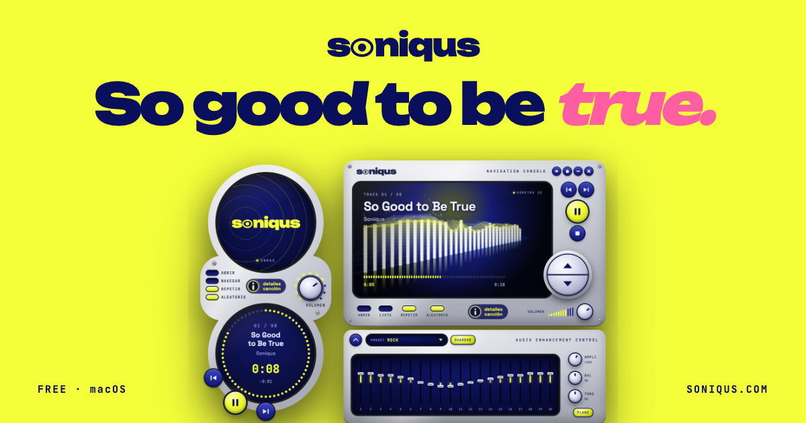
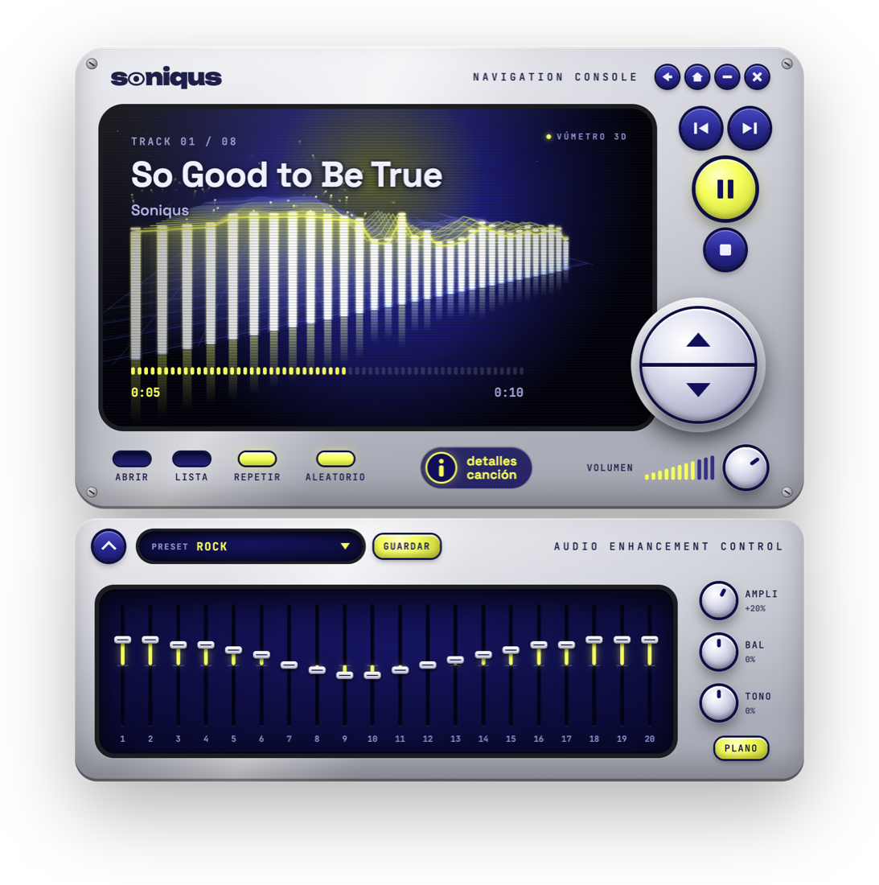
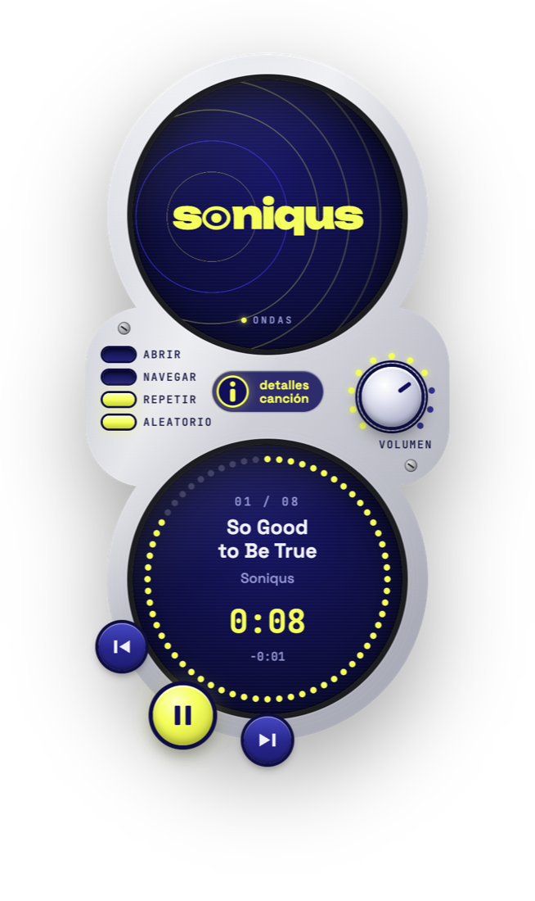
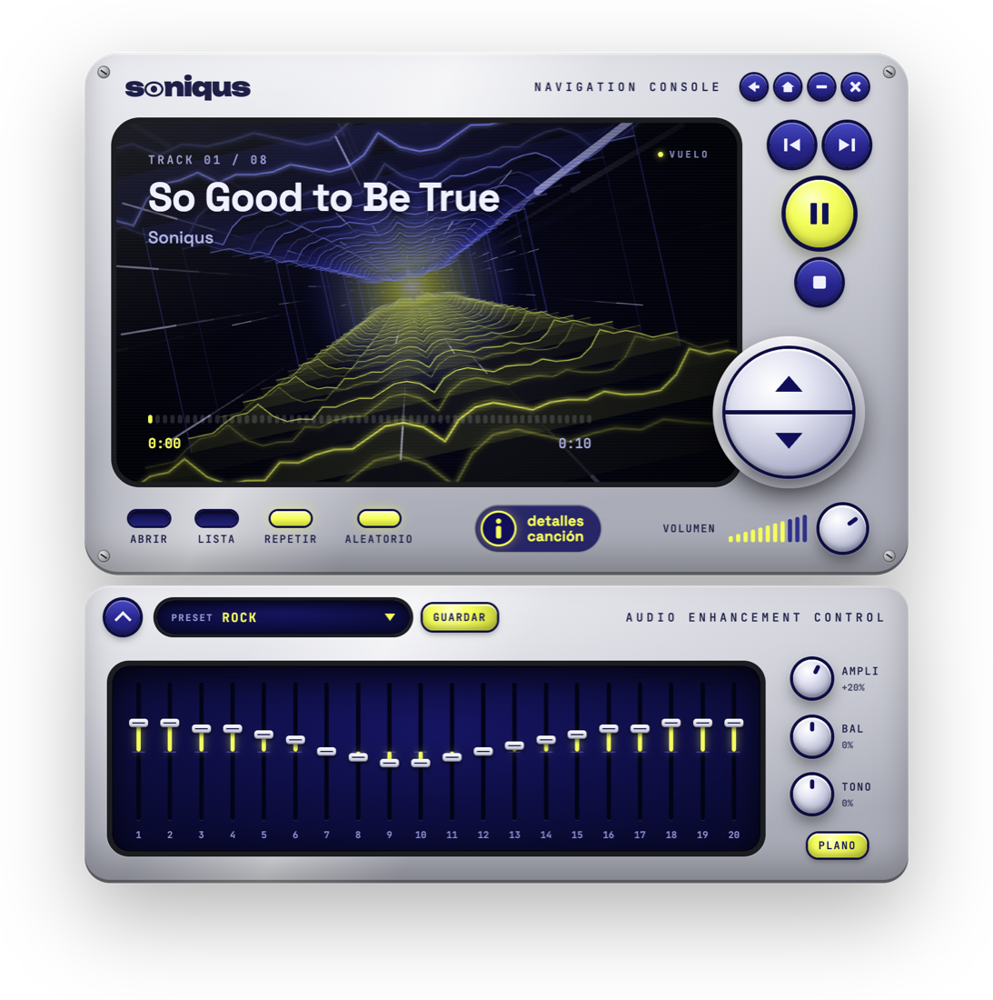
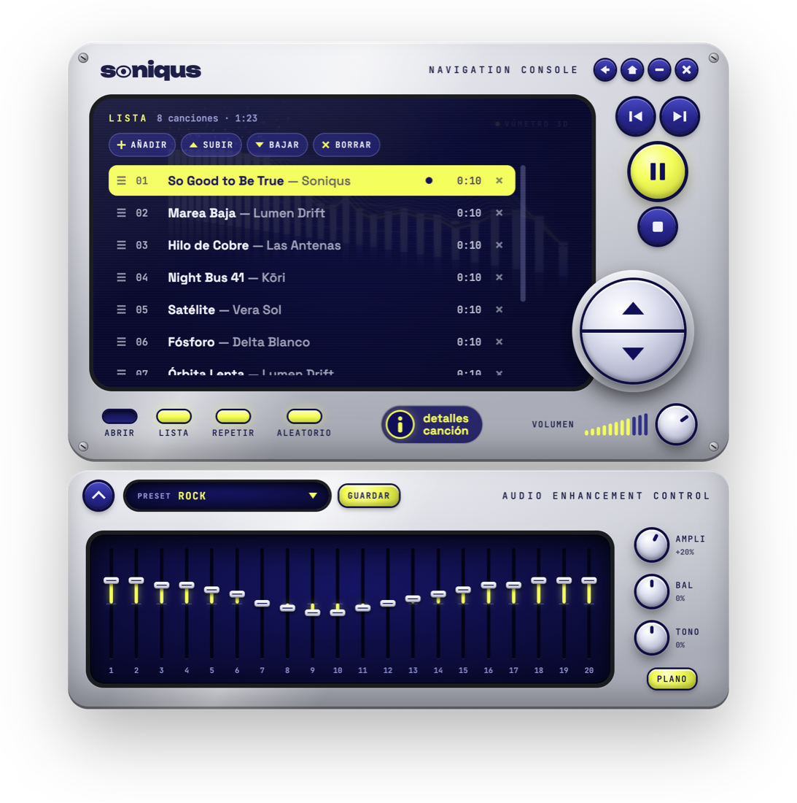
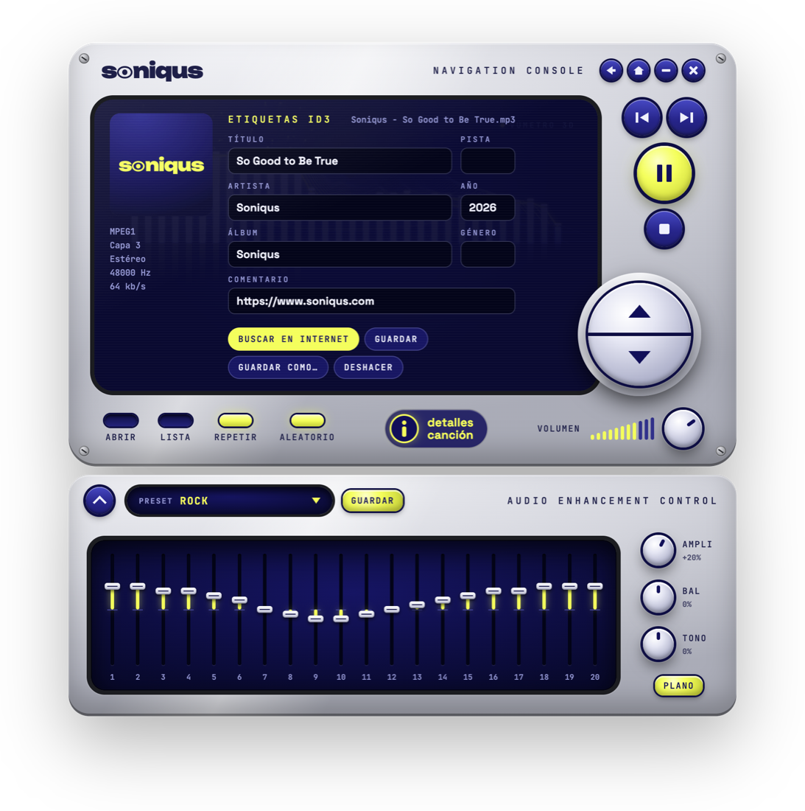
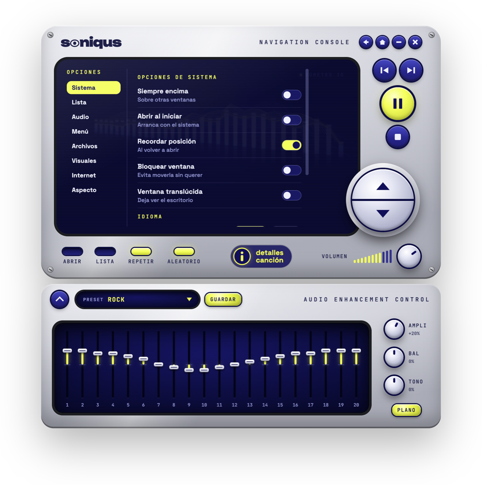
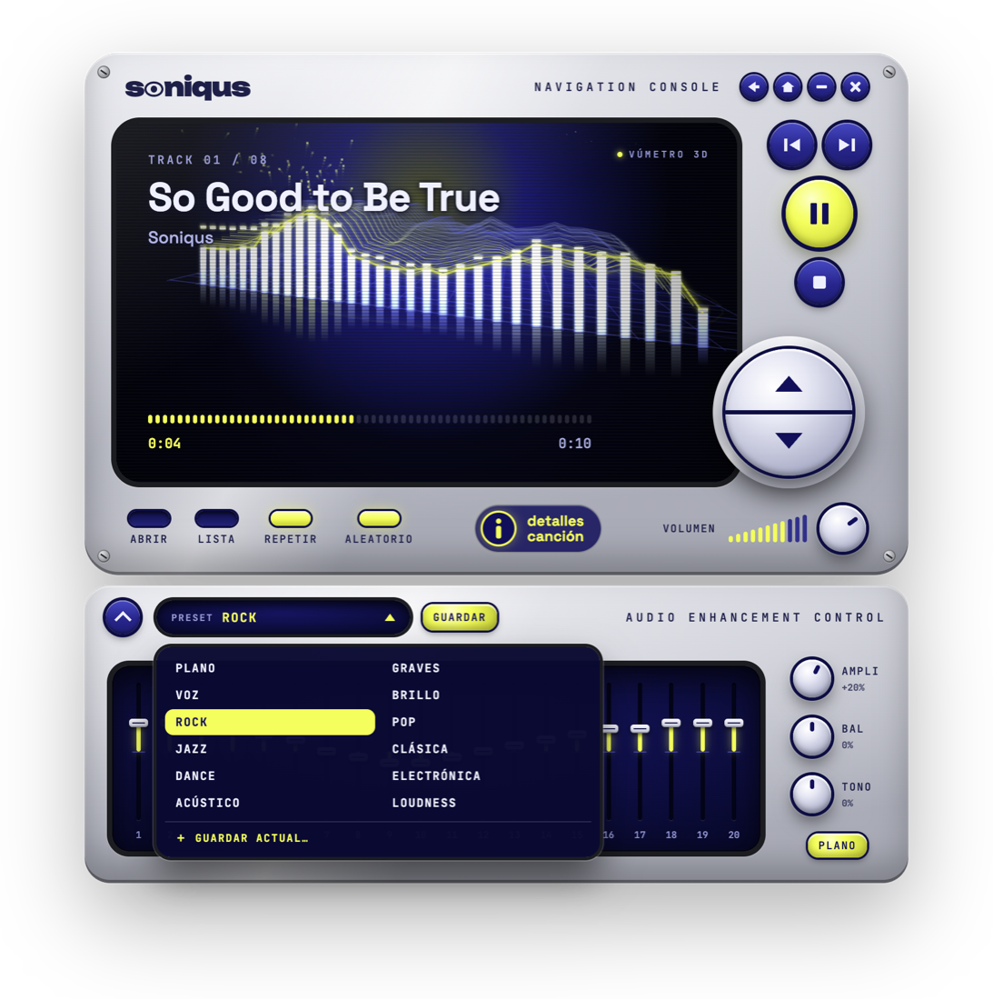
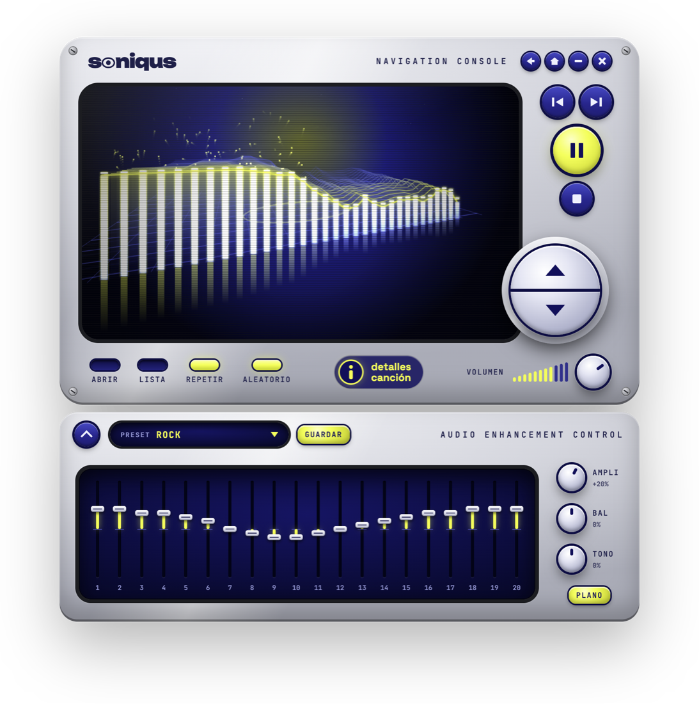
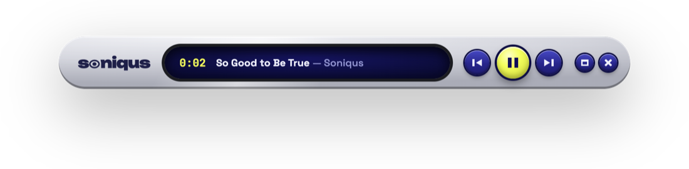

<p align="center">
  <a href="https://soniqus.com"></a>
</p>

<h1 align="center">soniqus</h1>

<p align="center">
  <b>The music player your desktop has been missing since 1999.</b><br>
  Real hardware vibes, visuals that dance to every beat, and zero subscriptions.
</p>

<p align="center">
  <a href="https://github.com/nuvolacat/Soniqus/releases/latest"></a>
  
  <a href="LICENSE"></a>
  <a href="https://soniqus.com"></a>
</p>

<p align="center">
  <a href="README.es.md">Leer en castellano</a>
</p>

---

<p align="center">
  
  
</p>

## What is it

**soniqus** is a free, open-source desktop music player for macOS. It is a love letter to the skinned players of the late 90s: a physical-looking case, round screens, hardware-style buttons, audio-reactive visuals and a 20-band equalizer — rebuilt from scratch with today's tools.

No account, no ads, no telemetry. It plays the files you already have.

## Download

Grab the latest `.dmg` from the **[Releases page](https://github.com/nuvolacat/Soniqus/releases/latest)** or from **[soniqus.com](https://soniqus.com)**, open it and drag soniqus to Applications.

> **First launch.** The build is not notarized by Apple yet, so macOS will refuse to open it the first time. Right-click the app and choose **Open**, or allow it in *System Settings → Privacy & Security*. Apple Silicon only for now.

## Features

| | |
|---|---|
| **Three window modes** | Compact twin-screen player, full *Navigation console*, and a tiny mini bar. Frameless, shaped windows you can drag anywhere. |
| **20-band equalizer** | −12…+12 dB per band, plus amp, balance and pitch knobs (double-click a knob to reset it). |
| **EQ presets** | Twelve built-in curves (Flat, Bass, Voice, Treble, Rock, Pop, Jazz, Classical, Dance, Electronic, Acoustic, Loudness) and your own: save the current curve with a name, delete it when you're done. |
| **Four live visuals** | Rings, 3D VU meter, Halo and Flight — all driven by the real audio signal. Click the screen to clear the text and leave only the visual. |
| **Playlist editor** | Add files or folders, drag to reorder, keyboard shortcuts, `m3u` / `pls` / `cue` playlists. |
| **ID3 tag editor** | Reads ID3v1/v2.2/2.3/2.4, writes ID3v2.4 back to the file keeping the cover and every other frame. |
| **Online lookup** | Fill in missing tags and cover art from MusicBrainz and the Cover Art Archive in one click. |
| **Six skins** | Light aluminium, brushed metal, matte graphite, anodized blue, smoke plastic, signal yellow. |
| **Screen transitions** | Iris, CRT sweep, vortex, glitch, 3D flip, slide — with staggered block animations. |
| **Audio extras** | Reverb, fade in/out, record the output to WAV, follow the system master volume. |
| **Formats** | MP3, FLAC, OGG, Opus, WAV, M4A, AAC, and internet radio streams from playlists. |
| **Languages** | Español, Català, English. |
| **Desktop manners** | Always on top, translucent window, lock position, open at login, remember position. |

<p align="center">
  
  
</p>
<p align="center">
  
  
</p>
<p align="center">
  
  
</p>
<p align="center">
  
</p>

## Keyboard shortcuts

| Key | Action |
|---|---|
| `Space` | Play / pause |
| `←` / `→` | Seek 5 s back / forward |
| `↑` / `↓` | Previous / next visual (or move through the playlist) |
| `Enter` | Play the selected song |
| `Delete` | Remove from the playlist |
| `⌥↑` / `⌥↓` | Move the selected song |
| `Esc` | Back |
| `⌘1` / `⌘2` / `⌘3` | Compact mode / console / mini bar |
| `⌘O` | Open files or folders |
| `⌘S` | Save the playlist as `m3u` |

Double-click the case to switch between compact mode and the console. Drop files or folders anywhere on the window to add them. Click anywhere on the progress bar (or the dotted ring in compact mode) to seek; click the top screen in compact mode to switch visuals.

## Build from source

Requirements: macOS, [Node.js](https://nodejs.org) 22 or newer. For the installer you also need [`uv`](https://docs.astral.sh/uv/) (it runs `dmgbuild`).

```bash
git clone https://github.com/nuvolacat/Soniqus.git
cd Soniqus
npm install

npm start        # build the UI and run the app
npm run dist     # build Soniqus.app and the .dmg into release/
npm run web      # build the website into web/dist (needs a .dmg in release/)
```

### Silent self-test

The app can drive itself through every screen with the audio muted, save a screenshot of each one and write a report — handy to check a change without touching the mouse:

```bash
SONIQUS_TEST=/tmp/soniqus-test npx electron .
```

## How it is built

soniqus is an [Electron](https://www.electronjs.org) app with a [React](https://react.dev) UI, bundled with [esbuild](https://esbuild.github.io).

```
main.js              main process: shaped window, sq:// protocol, files, playlists, dialogs
preload.js           the bridge exposed to the UI
tags.js              ID3 reader / writer and MPEG header parser
src/renderer/        UI logic (app.jsx), i18n and styles
diseno/              the original design prototype — the single source of truth for the UI
tools/convert.mjs    turns the design prototype into React views at build time
tools/build.mjs      bundles the UI and stamps the version
tools/dist.mjs       packages the app, draws the icon and builds the .dmg
tools/selftest.js    the silent self-test
web/                 the soniqus.com website generator
```

A few things worth knowing:

- **The UI is generated from the design.** `tools/convert.mjs` reads the HTML prototype in `diseno/` and emits the React views, so the app stays pixel-faithful to the design. Edit the prototype or the converter, never the generated files.
- **Audio** goes through the Web Audio API: preamp → 20 peaking filters → reverb send → stereo panner → analysers → fade → volume. Local files are served to the player through a private `sq://` protocol with HTTP range support.
- **Shaped windows.** The window is transparent and frameless; clicks on the empty margin fall through to whatever is behind it while soniqus is the active window.
- **Versions** follow `1.YY.MMDD.HHMM`, taken from the real build time.

## Privacy

soniqus only talks to the internet when you ask it to: looking up tags (MusicBrainz), fetching a cover (Cover Art Archive) or playing a radio stream you added. Settings and the playlist live in `~/Library/Application Support/Soniqus`; *Settings → System → Clear cache* wipes them.

## Contributing

Issues and pull requests are welcome. Please keep changes consistent with the design prototype and run the silent self-test before sending a PR.

## License

The source code is released under the [MIT License](LICENSE): you are free to use, modify and redistribute it, including commercially, **as long as you give credit**.

**Giving credit** means keeping the copyright notice and the license text (`Copyright (c) 2026 NUVOLACAT` and the [LICENSE](LICENSE) file) in every copy or substantial portion of the code, in source or binary form. If you ship an app built on soniqus, a line such as *“Based on soniqus by NUVOLACAT — https://github.com/nuvolacat/Soniqus”* in your About screen or documentation is the way to do it.

The **soniqus** name and logo, the app icon and the bundled welcome song *“So Good to Be True”* are © NUVOLACAT and are not covered by the MIT License — please use your own if you publish a derived player.

soniqus bundles the typefaces Unbounded, Space Grotesk and JetBrains Mono (SIL Open Font License 1.1). It is an independent project, not affiliated with Sonique or its owners.

---

<p align="center">
  Made by <a href="https://nuvola.cat">nuvola</a>
</p>
